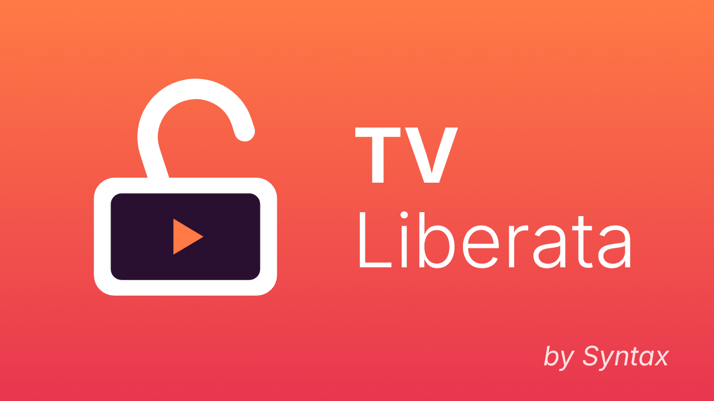

<p align="center"></p>

# TV Liberata

Una Home pulita per Fire TV Stick (e per le TV Android TV / Google TV): niente pubblicità, niente righe
consigliate, solo le tue app su uno sfondo che cambia, con meteo e uno screensaver vero. Una sola app per Fire TV e
Android TV: riconosce da sola su quale gira.

Non serve root, non si disinstalla niente di Amazon: la Home Amazon resta installata e si torna indietro in un
attimo (vedi [Tornare alla Home Amazon](#tornare-alla-home-amazon)).

## Cosa fa

- **Home con sfondi**: foto del giorno di Bing e di Wikimedia Commons, scaricate sulla TV e tenute in un
  archivio. Le puoi attivare, disattivare, mettere tra le preferite o eliminare; cambiano da sole ogni 15, 30 o
  60 minuti e, se vuoi, a ogni accensione.
- **Le tue app**: una riga in basso e una griglia, che riordini e da cui nascondi quello che non usi (tieni premuto
  OK su un'app: Sposta, Togli dalla Home, **Disinstalla**). L'elenco delle app nascoste è in Impostazioni TV Liberata,
  App. Lo store (Appstore su Fire TV, Play Store su Android TV) resta sempre in Home.
- **News**: la striscia delle notizie ANSA, in Home e sullo screensaver, con le sezioni che scegli (spenta finché non
  la accendi).
- **Temi**: lo stile dei menu (Palloncini, Segmentati, Elenco, Solo testo), il colore principale e lo sfondo dei menu.
- **Meteo** in alto, per la tua città: trovata da sola dalla connessione internet, o scelta a mano.
- **Screensaver**: Orologio, "Preferite" (le tue foto preferite con dissolvenza e zoom lento) e, su Fire TV, Amazon
  Foto; "Avvia dopo" 1, 3, 5, 10, 15 o 30 minuti.
- **Margini schermo** per le TV che tagliano i bordi, **pulsante ⏻ "Spegni tutto"**, sezione **Sistema** (memoria,
  spazio, rete, pulizia, stato dei servizi, versione e canale).
- **Filtro DNS integrato** (Sistema → Filtro): blocca telemetria, pubblicità e aggiornamenti di Fire OS per tutta la
  TV, con una VPN locale che porta solo il DNS (lo streaming non passa di lì). Eccezioni e statistiche dal telecomando.
- **Catalogo** (Impostazioni TV Liberata, App): VLC, SmartTube, RetroArch, Moonlight, TV Bro, Aerial Views dalla loro
  fonte ufficiale, e Spotify, TIDAL, X-plore, Send Files to TV, Downloader dallo store; le app libere si installano dopo il controllo
  dell'impronta e della firma.
- **Ripristina tutto**: riattiva le app di sistema che TV Liberata ha disattivato (serve il debug della TV, vedi sotto).
- **Aggiornamenti automatici**: di notte, a TV spenta, oppure proposti all'accensione.

Tutto si regola da **Impostazioni TV Liberata**, l'app delle impostazioni che arriva insieme alla Home.

## Requisiti

- Fire TV con **Fire OS 7 o più recente** (provata su Fire TV Stick Lite e Fire TV Stick 3ª gen.; vanno anche
  Fire TV Stick 4K e 4K Max), oppure una TV **Google TV / Android TV con Android 8** o più recente.
- **Non funziona** sulle Fire TV con Fire OS 5 (es. Fire TV Stick 2ª gen. del 2016) né sui modelli nuovi con
  **Vega OS**, che non permettono di installare app. Il programma per PC lo riconosce e si ferma prima di cambiare
  qualcosa.
- Un PC Windows 10 o 11 sulla stessa rete della TV, per l'installazione consigliata.
- Connessione internet (per sfondi e meteo; senza rete restano le foto già scaricate).

## Installazione (dal PC, consigliata)

Si fa **una volta** da un PC Windows sulla stessa rete della TV: dopo, il PC non serve più.

1. Sulla TV: Impostazioni, La mia Fire TV, Informazioni, premi OK 7 volte sul nome del dispositivo; poi in
   Opzioni sviluppatore attiva **Debug ADB**.
2. Sul PC apri **`tinyurl.com/Tv-liberata-pc`** (scarica
   [Configura-TV-Liberata.zip](https://github.com/turillo/tv-liberata-pubblico/releases/latest/download/Configura-TV-Liberata.zip)),
   estrai lo zip e fai doppio clic su `Configura-TV-Liberata.bat`.
3. Conferma la TV trovata, sulla TV spunta "Consenti sempre" e premi OK, poi rispondi alle domande.

Il programma installa TV Liberata, la rende Home, disattiva (senza cancellarle) le app Amazon di pubblicità e
telemetria e lascia un backup per tornare indietro (scelta 2, "Annulla tutto e torna come prima"). Le liste che usa
sono in questo repository: [pacchetto-app.json](pacchetto-app.json) e [pulizia-fireos.json](pulizia-fireos.json).

La guida passo passo: [Guida-installazione-TV-Liberata.txt](Guida-installazione-TV-Liberata.txt); in breve:
[Guida-rapida-TV-Liberata.txt](Guida-rapida-TV-Liberata.txt). Per le TV Android TV / Google TV cambiano solo i menu
(appendice A della guida).

### Senza PC: Downloader (alternativa)

1. Installa **Downloader** (AFTVnews) dall'Appstore e consenti "Installa app sconosciute" per Downloader
   (Impostazioni, La mia Fire TV, Opzioni sviluppatore).
2. In Downloader scrivi il codice **`8520002`** (oppure `tinyurl.com/tvliberata`) e installa.
3. Apri **TV Liberata** dalle tue app: parte la configurazione guidata.

**Limite di Fire OS 7.7** (le Fire TV più diffuse): senza PC TV Liberata funziona come app normale ma **non diventa
la Home** e la pulizia delle app Amazon non si fa, perché Amazon non permette alle app di configurare la TV da sole.
Appena hai un PC, fai l'installazione dal PC qui sopra: completa la configurazione.

### Per chi usa già adb

Dalla cartella `launcher` di questo repository, con `tv-liberata.apk` dell'ultima
[Release](https://github.com/turillo/tv-liberata-pubblico/releases/latest):

```powershell
.\firetv-home.ps1 -TvHost 192.168.1.60 -NoBuild -Apk C:\percorso\tv-liberata.apk
```

Lo script salva prima le impostazioni che tocca, installa l'app, la rende Home e controlla che il tasto Home porti
qui; se qualcosa non va rimette da solo la Home Amazon.

## Aggiornamenti

Ogni notte verso le 4, se la TV è spenta, l'app controlla le Release di questo repository. Se hai autorizzato il
debug della TV (Impostazioni TV Liberata, Sistema, Ripristina tutto, **Autorizza**, poi "Consenti sempre" sulla TV)
installa la nuova versione da sola, e alla prima accensione ti dice "TV Liberata è stata aggiornata alla versione X"
con le novità. Senza quell'autorizzazione te la propone all'accensione; in Sistema, "Cerca aggiornamenti" controlla
subito. In quel caso l'installazione va consentita una volta: Impostazioni, La mia Fire TV, Opzioni sviluppatore,
**Installa app sconosciute**, attiva **TV Liberata**. Si installano solo aggiornamenti firmati con la stessa chiave.

Su Fire OS 7.7 Amazon non permette alle app di usare il debug della TV stessa (provato su Fire TV Stick Lite):
lì la configurazione la fa una volta il programma per PC (Configura-TV-Liberata.zip, vedi sopra). Dopo, TV Liberata
scarica gli aggiornamenti, ne controlla la firma e conferma da sola l'installazione di sistema; "Ripristina tutto" si
fa dal programma per PC ("Annulla tutto e torna come prima").

L'autorizzazione del debug permette all'app di dare comandi alla TV come farebbe un PC collegato: la usa solo per
installare i propri aggiornamenti, per la configurazione guidata e per "Ripristina tutto". Il debug ADB deve restare
acceso; chi è sulla stessa rete di casa può collegarsi alla porta 5555, ma solo dopo una conferma sullo schermo.

## Tornare alla Home Amazon

- Dal telecomando: Impostazioni, Accessibilità, disattiva **Home Fire TV** (se la tua Fire TV la elenca). Oppure
  disinstalla TV Liberata: la Home Amazon torna subito.
- Via adb: `adb shell settings delete secure enabled_accessibility_services`, poi premi Home.

Se dopo un aggiornamento di Fire OS ricompare la Home Amazon, TV Liberata si riprende la Home da sola al
riavvio successivo; nel frattempo la trovi tra le tue app ("Le tue app e i tuoi canali"), e con il tasto Opzioni
puoi spostarla in prima fila.

## Privacy

Nessun account, nessuna statistica, nessuna pubblicità. L'app chiede solo: le foto a Bing e Wikimedia Commons, il
meteo a [Open-Meteo](https://open-meteo.com), la città dalla connessione a [ipwho.is](https://ipwho.is) (una volta a
settimana, se non l'hai scelta a mano), le liste del filtro a jsDelivr (HaGeZi), e le Release, il catalogo e
`produzione.json` a GitHub.

## Compilare da sé

JDK 17 e Android SDK 34. Nella cartella `launcher`: `./gradlew assembleRelease`. Senza la chiave di firma
del progetto l'APK è firmato con la chiave di debug e non si aggiorna dalle Release.

## Crediti e licenza

TV Liberata nasce da [cleanyourtv](https://github.com/audiedv/cleanyourtv) di Gathin (licenza MIT), di cui
riusa il launcher; le aggiunte sono rilasciate con la stessa licenza MIT (file [LICENSE](LICENSE)). Il carattere
Outfit è distribuito con la SIL Open Font License 1.1 ([launcher/FONT-LICENSE-OFL.txt](launcher/FONT-LICENSE-OFL.txt)).
Foto: Bing (© dei rispettivi autori, uso come sfondo personale) e Wikimedia Commons (autore e licenza mostrati
sotto ogni foto). Meteo: Open-Meteo (CC BY 4.0). Immagini: NASA, ESA/Webb, ESA/Hubble, EUMETSAT.
"Fire TV" e "Firestick" sono marchi di Amazon; questo progetto non è affiliato ad Amazon.
